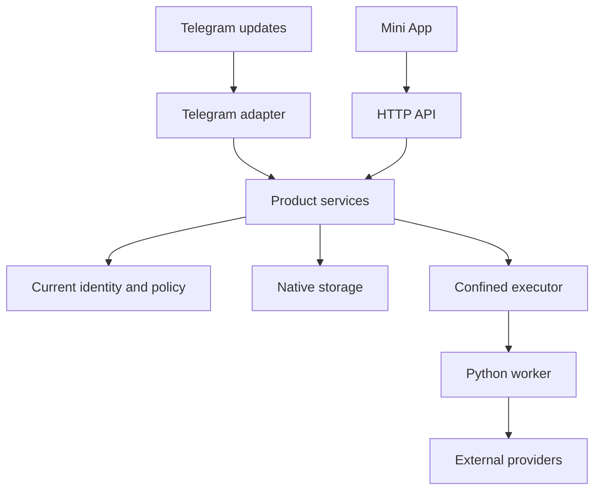

# Runtime architecture

Yoink uses one Rust process for the Telegram bot, HTTP API, and product services. Native Turso stores application state in a private local database. The React Mini App uses the same authenticated API.

## Components

| Component | Responsibility |
| --- | --- |
| `yoink-server` | Configuration, construction, readiness, and startup/shutdown ownership. |
| `yoink-http` | Authentication, administration, product routing, health, and metrics. |
| `yoink-telegram` | Polling, trusted update context, command dispatch, menus, and delivery. |
| `yoink-identity` | Current roles, bans, grants, memberships, and profile/settings transactions. |
| `yoink-storage` and `yoink-db` | Schema checks, serialized database access, durable operations, and delivery journals. |
| `yoink-downloads` | Download admission, preferences, credentials, quotas, and media lifecycle. |
| `yoink-music`, `yoink-stats`, `yoink-insight`, `yoink-inbox` | Product use cases and their persistence/API contracts. |
| `yoink-executor` and `yoink-worker-protocol` | Confined worker launch, bounded messages, and artifact validation. |
| `yoink-i18n` | Embedded English and Russian Telegram messages. |

The crate manifests under [backend/crates](../../backend/crates/) define dependency boundaries. Plugin repositories supply frontend pages and retained Python reference code. They are not independent services in the native deployment.

## Request flow

Telegram ingress and HTTP authentication establish the actor. Services check current database authority instead of trusting a JWT role or request-body user ID.

Downloads freeze request and credential references at admission. Execution and delivery recheck authorization and those references. Inline discovery alone does not authorize later delivery into a chat.

## Storage and lifecycle

One server process owns each database file. An advisory sidecar lock excludes another cooperating owner. One serialized connection serves application queries and transactions.

The standalone server verifies an existing schema. Explicit `migrate` creates or upgrades the database. The container entrypoint runs the same server binary. It does not add an automatic migration step.

Readiness stays false during initialization and shutdown. Runtime owners retain tasks, workers, database handles, and search writers until cancellation and drain complete.

## External effects

Durable journals distinguish confirmed, rejected, and unknown Telegram or GitHub effects. Database fencing cannot guarantee exactly-once external delivery. An ambiguous send must not trigger an automatic resend.

Workers use cleared environments, guarded network access, bounded workspaces, and Landlock confinement. These controls do not replace host security or operator-managed egress policy.

## Related contracts

- [Access control](access-control.md)
- [Persistence and recovery](persistence.md)
- [Worker protocol](worker-protocol.md)
- [Product lifecycle](products.md)
- [Deployment](../operations/deployment.md)
